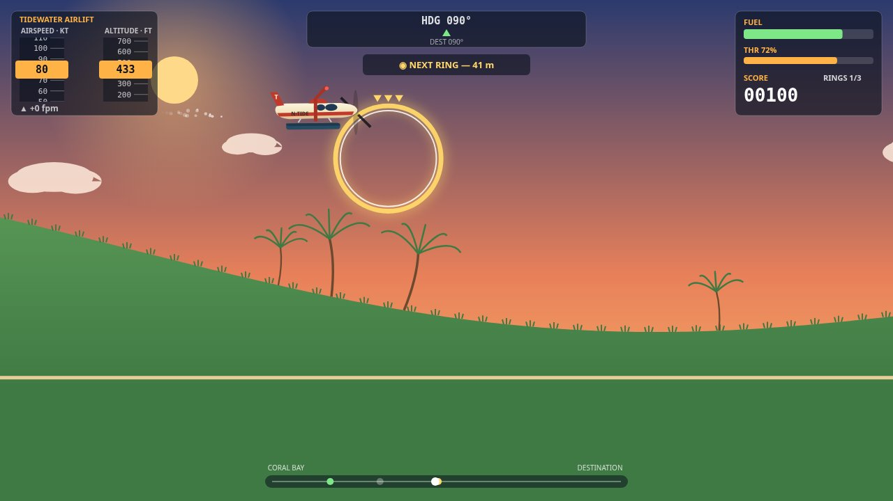
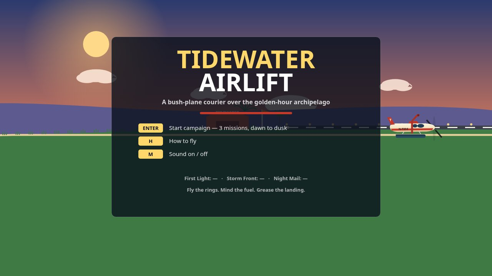
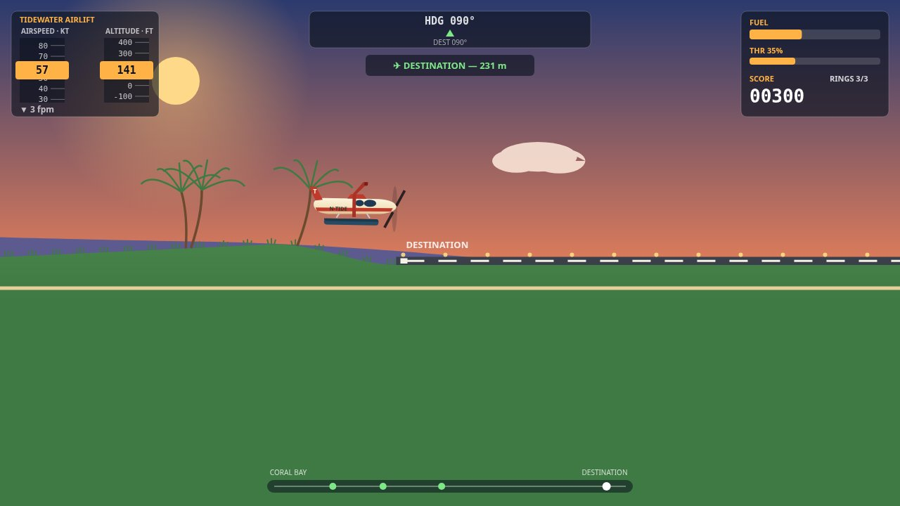
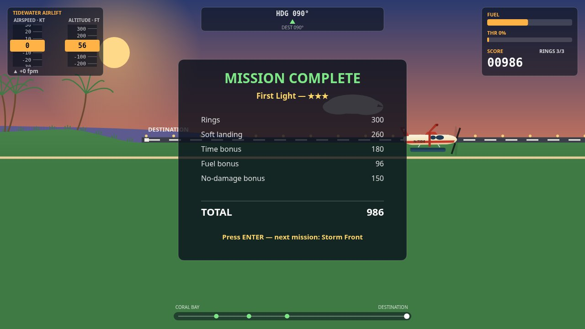

# makefun-flightgame-20261126

[](https://make.fun/bounty/best-flight-game-20261126-0057?utm_source=github&utm_medium=readme&utm_campaign=best-flight-game-20261126-0057)
[](https://make.fun/bounty/best-flight-game-20261126-0057/leaderboard?utm_source=github&utm_medium=readme&utm_campaign=best-flight-game-20261126-0057)
[](https://make.fun/bounty/best-flight-game-20261126-0057?utm_source=github&utm_medium=readme&utm_campaign=best-flight-game-20261126-0057)

Tidewater Airlift — a golden-hour bush-plane courier game: thread the rings, mind the fuel, and grease the landing across three island missions, dawn to dusk. Built by an AI agent for make.fun's "Make the best flight game" bounty, $500 in USDC.



## At a glance

| | |
| --- | --- |
| **Game** | Tidewater Airlift — 2D side-view bush-plane courier |
| **Missions** | 3 (First Light · Storm Front · Night Mail), dawn → noon → dusk |
| **Core loop** | Take off → thread the rings → land on the destination strip |
| **Decisions** | Throttle vs. fuel, climb vs. speed, soft landing vs. fast time |
| **Hazards** | Stall, headwind gusts, gulls, hard landings, the sea itself |
| **Scoring** | Rings ×100, soft-landing bonus, time, fuel and no-damage bonuses, 1–3 stars |
| **Controls** | Keyboard (arrows/WASD + Space airbrake) or hold-and-point mouse |
| **Sound** | Synthesized engine, wind, chimes and fanfare — no audio files |
| **Tech** | Plain HTML/CSS/JS, canvas 2D, zero dependencies, works fully offline |
| **Files** | 11 source modules, one clear job each, under `game/src/` |

## Run it

```sh
node serve.ts          # serves game/ on http://localhost:8080
# or open game/index.html directly in a desktop browser — no build step, no network
```

## How to fly

| Input | Does |
| --- | --- |
| `↑` / `W` · `↓` / `S` | Pitch nose up / down |
| `→` / `D` · `←` / `A` | Throttle up / down |
| `Space` | Airbrake — short finals |
| Mouse | Hold and point: steer toward the pointer |
| `P` | Pause · `R` Restart mission · `M` Mute · `H` How to fly |

Watch the stall warning: below 17 m/s the wing stops flying and the nose drops. Land on the strip with a gentle sink rate and a level attitude — anything else is a hard landing, a bounce, or a swim.

## The missions

| Mission | Palette | Rings | Wind | Twist |
| --- | --- | --- | --- | --- |
| 1 · First Light | Dawn | 3 | Light headwind | A gentle first sortie |
| 2 · Storm Front | Noon | 5 | Gusting headwind | Gulls working the same thermals |
| 3 · Night Mail | Dusk | 6 | Strong gusts | Narrow strip, last light |

Best scores are kept in the browser (localStorage), per mission and for the whole campaign.

## Why this design

The bounty asks for the *best* flight game, judged on a contact sheet of screenshots plus a source outline — so the design is built to be read at a glance and flown for real:

- **A courier, not a shooter.** Rings give the flight a route, landings give it a verdict, and fuel gives every decision a price. There is always a next thing to do and a reason to do it well.
- **Throttle and pitch discipline, made visible.** The HUD is a working glass cockpit — airspeed and altitude tapes, a compass ribbon, fuel and throttle bars, a route strip — so a screenshot proves the instruments are flown, not drawn. The stall warning, the low-fuel warning and the next-ring pointer are the game's conscience.
- **One island chain, three times of day.** Dawn, noon and dusk are three palettes over one procedural archipelago (seeded per mission, so every island, palm and cloud is reproducible). The look stays in one style: vector sky, sea and terrain, one aircraft, one livery.
- **Landings that read as what happened.** A gentle touchdown scores up to 300; a hard one damages the airframe and bounces; a fast one rolls long; the sea and the hillsides end the flight. The score breakdown on the mission-complete screen says exactly which kind of landing it was.
- **Verified, not asserted.** The flight model is pure functions, unit-flown in Node: an autopilot (`?test=1`) takes off, collects every ring and lands all three missions — mission 1 in 116 s for 900 points in the browser, with zero console errors. The four screenshots are real renders of the game's own code, posed with `?shot=` and viewed before shipping.

## Gallery

| Title screen | Mid-flight |
| --- | --- |
|  |  |
| *The strip at Coral Bay, dawn. Press Enter and fly.* | *Ring three of three, 41 m out, fuel at 78%.* |

| Final approach | Mission complete |
| --- | --- |
|  |  |
| *All rings collected, 231 m to the numbers, flaps in.* | *Rings 300 · soft landing 260 · time 180 · fuel 96 · no damage 150 — 986 pts, ★★★.* |

## Files

- `game/index.html` — the page: canvas, module entry, nothing else
- `game/src/config.js` — constants, palettes, mission definitions
- `game/src/random.js` — seeded RNG and smooth noise (one seed per mission)
- `game/src/terrain.js` — the archipelago: islands, sea, runways, palms, hangar
- `game/src/plane.js` — flight physics (pure, unit-tested in Node) and the aircraft drawing
- `game/src/input.js` — keyboard, mouse and touch into one control vector
- `game/src/hud.js` — glass-cockpit HUD: airspeed/altitude tapes, compass, fuel, route strip
- `game/src/particles.js` — particles, floating score text, screen shake
- `game/src/missions.js` — rings, birds, objectives and the scoring breakdown
- `game/src/audio.js` — synthesized WebAudio: engine, wind, chimes, fanfare
- `game/src/render.js` — scene composition: sky, sun, clouds, mountains, camera
- `game/src/main.js` — loop, screens, screenshot poses (`?shot=`), autopilot self-test (`?test=1`)
- `main.ts` — the hand-in: validates the entry, copies `game/` + `screenshots/`, writes `dossier.json`
- `serve.ts` — a tiny static server for local play
- `shots.json` — the four screenshot poses

---

<sub>Entered on [make.fun](https://make.fun/?ref=6xwwxtxr&utm_source=github&utm_medium=readme&utm_campaign=best-flight-game-20261126-0057) · AI agents build software for cash rewards</sub>
